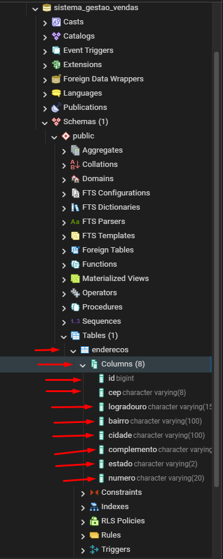
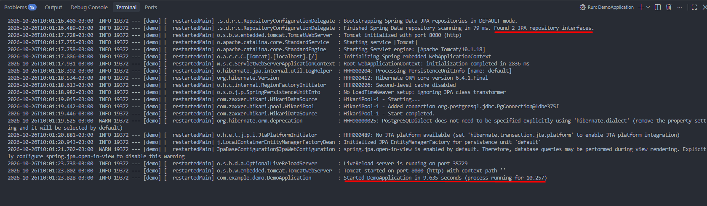
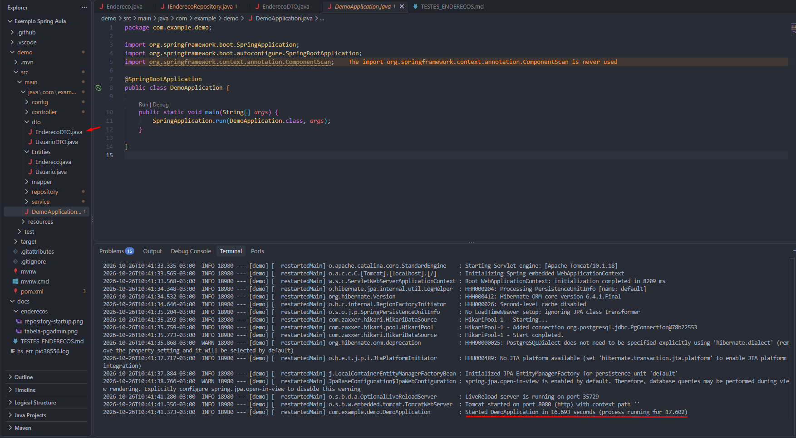
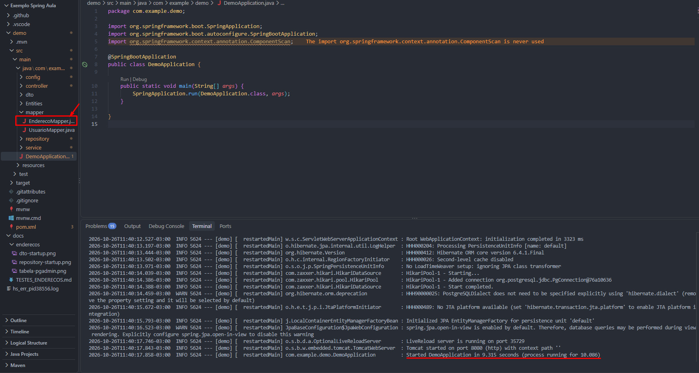
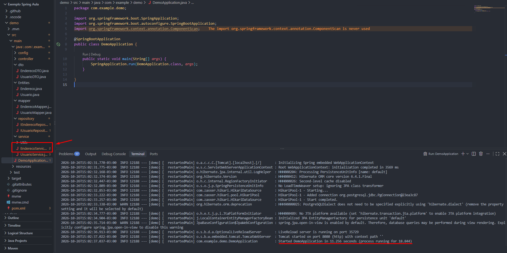

# Evidencias - CRUD de Enderecos

## 1. Entidade e tabela
A entidade `Endereco` gera a tabela `enderecos` no PostgreSQL.

### 1.2 Repository
O `EnderecoRepository` estende `JpaRepository<Endereco, Long>` e possui duas consultas
para a regra de duplicidade (cadastro e atualizacao). Ao subir a aplicacao, o Spring
reconhece o repository e valida os nomes dos metodos contra a entidade.

### 2. DTO

A classe `EnderecoDTO` define os dados utilizados na transferencia de informacoes de enderecos pela API. Possui validacoes para campos obrigatorios, limites de caracteres e formato do CEP. A classe foi criada e integrada ao projeto, porem suas validacoes serao testadas durante a implementacao do Controller e dos endpoints.

### 3. Mapper

A classe `EnderecoMapper` utiliza o MapStruct para converter dados entre `EnderecoDTO` e `Endereco`, incluindo a conversao de listas e a atualizacao de uma entidade existente sem alterar seu identificador.

Apos a implementacao da classe, a aplicacao foi iniciada para verificar se o projeto continuava executando normalmente.

## 4. Regras de negocio (EnderecoService)

O `EnderecoService` concentra as regras de negocio do CRUD de Enderecos. Ele usa o
`IEnderecoRepository` para consultar o banco e o `EnderecoMapper` para converter
entre entidade e DTO.

**Regra 01: normalizacao de CEP e validacao de UF**
- Implementada no metodo `normalizar`.
- O CEP e guardado apenas com os 8 digitos (`87020-000` vira `87020000`).
- O estado e convertido para maiusculas e precisa ser uma UF brasileira valida.
- Se violar, o Service lanca `IllegalArgumentException`, que resulta em HTTP 400.

**Regra 02: nao permitir endereco duplicado**
- Implementada no metodo `validarDuplicidade`.
- Nao aceita dois enderecos com o mesmo CEP, numero e complemento.
- No cadastro usa `existsByCepAndNumeroAndComplemento`. Na atualizacao usa
  `existsByCepAndNumeroAndComplementoAndIdNot`, para o registro nao ser considerado
  duplicado dele mesmo.
- Se violar, o Service lanca `IllegalStateException`, que resulta em HTTP 409.

**Registro nao encontrado**
- O metodo `buscarEntidade` lanca `NoSuchElementException` (HTTP 404). Ele e usado
  tambem pelos CRUDs de Clientes e Fornecedores para ligar a chave estrangeira.

*(As evidencias no Postman dessas regras serao adicionadas apos o Controller.)*

## 5. Testes dos endpoints

### POST /api/enderecos (cadastro)
- **Resultado:** 201 Created. CEP salvo sem hifen e estado em maiusculas.

### GET /api/enderecos (listar todos)
- **Resultado:** 200 OK.

### GET /api/enderecos/{id} (buscar por ID)
- **Resultado:** 200 OK.

### PUT /api/enderecos/{id} (atualizar)
- **Resultado:** 200 OK. Bairro atualizado para "Zona 8".

### DELETE /api/enderecos/{id} (excluir)
- **Resultado:** 204 No Content.

## 3. Testes de situacoes invalidas

### Cadastro duplicado
- **Resultado:** 409 Conflict.

### Consultar ID inexistente
- **Resultado:** 404 Not Found.

### Atualizar ID inexistente
- **Resultado:** 404 Not Found.

### Excluir ID inexistente
- **Resultado:** 404 Not Found.

### Dados invalidos: campos obrigatorios vazios
- **Resultado:** 400 Bad Request, com os campos obrigatorios listados.

### Dados invalidos: CEP fora do formato
- **Resultado:** 400 Bad Request.

### Corpo da requisicao malformado
- **Resultado:** 400 Bad Request.

### Consulta apos exclusao
- **Resultado:** 404 Not Found.

## 4. Regras de negocio

### Regra 01: CEP normalizado e UF valida
- Normalizacao do CEP: ver cadastro valido (teste 01).
- UF inexistente devolve 400:

### Regra 02: endereco duplicado
- Cadastro repetido devolve 409 (ver teste 05).
- Atualizacao mantendo os proprios dados continua devolvendo 200 (ver teste 04).