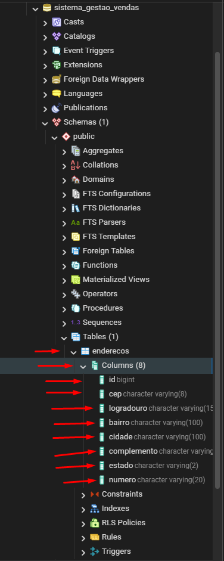
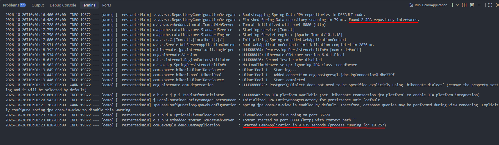
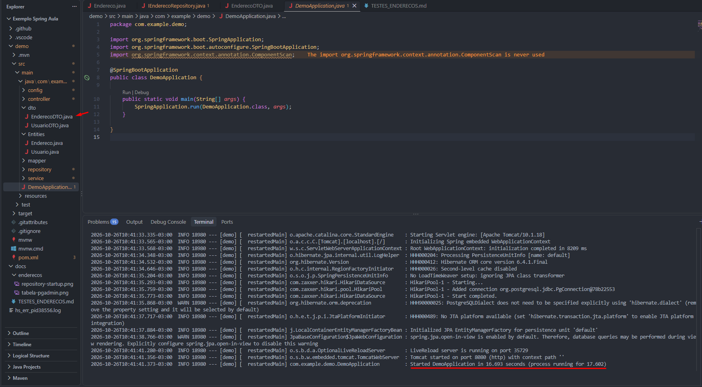
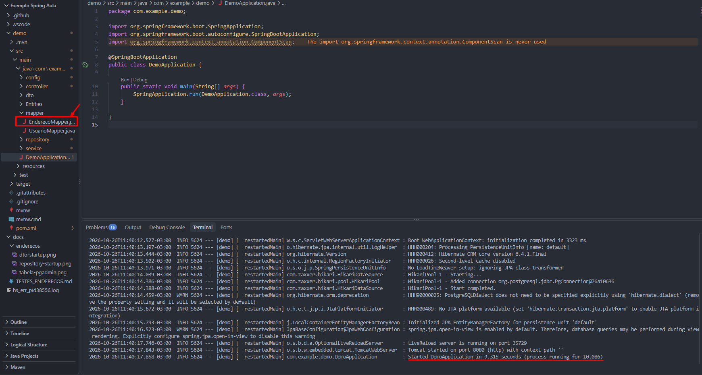
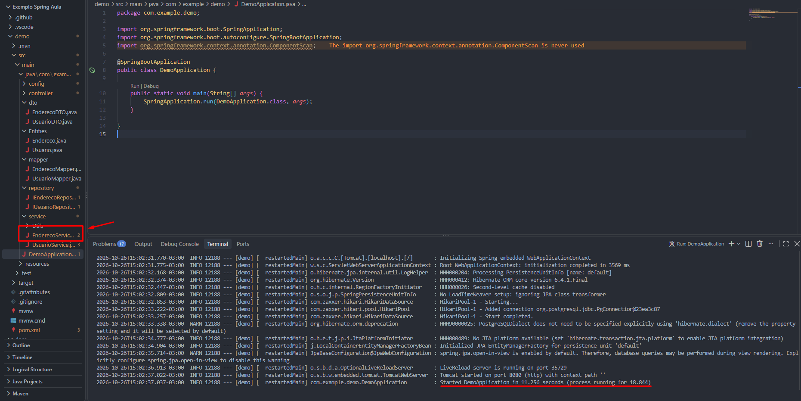

# Evidências - CRUD de Endereços

## 1. Entidade e tabela
A entidade `Endereco` gera a tabela `enderecos` no PostgreSQL.

### 1.2 Repository
O `EnderecoRepository` estende `JpaRepository<Endereco, Long>` e possui duas consultas
para a regra de duplicidade (cadastro e atualização). Ao subir a aplicação, o Spring
reconhece o repository e valida os nomes dos métodos contra a entidade.

### 2. DTO

A classe `EnderecoDTO` define os dados utilizados na transferência de informações de endereços pela API. Possui validações para campos obrigatórios, limites de caracteres e formato do CEP. A classe foi criada e integrada ao projeto, porém suas validações serão testadas durante a implementação do Controller e dos endpoints.

### 3. Mapper

A classe `EnderecoMapper` utiliza o MapStruct para converter dados entre `EnderecoDTO` e `Endereco`, incluindo a conversão de listas e a atualização de uma entidade existente sem alterar seu identificador.

Após a implementação da classe, a aplicação foi iniciada para verificar se o projeto continuava executando normalmente.

## 4. Regras de negócio (EnderecoService)

O `EnderecoService` concentra as regras de negócio do CRUD de Endereços. Ele usa o
`IEnderecoRepository` para consultar o banco e o `EnderecoMapper` para converter
entre entidade e DTO.

**Regra 01: normalização de CEP e validação de UF**
- Implementada no método `normalizar`.
- O CEP é guardado apenas com os 8 dígitos (`87020-000` vira `87020000`).
- O estado é convertido para maiúsculas e precisa ser uma UF brasileira válida.
- Se violar, o Service lança `IllegalArgumentException`, que resulta em HTTP 400.

**Regra 02: não permitir endereço duplicado**
- Implementada no método `validarDuplicidade`.
- Não aceita dois endereços com o mesmo CEP, número e complemento.
- No cadastro usa `existsByCepAndNumeroAndComplemento`. Na atualização usa
  `existsByCepAndNumeroAndComplementoAndIdNot`, para o registro não ser considerado
  duplicado dele mesmo.
- Se violar, o Service lança `IllegalStateException`, que resulta em HTTP 409.

**Registro não encontrado**
- O método `buscarEntidade` lança `NoSuchElementException` (HTTP 404). Ele é usado
  também pelos CRUDs de Clientes e Fornecedores para ligar a chave estrangeira.

*(As evidências no Postman dessas regras serão adicionadas após o Controller.)*

